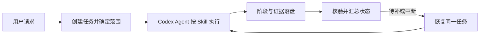

# 本地 Agent 工作流入口

在 Codex 对话中输入“用工作流查找我 Zotero 库里的 OpenVLA”或“用工作流帮我读某篇论文”。Agent 使用本项目 Skill 处理论文，脚本保存原始请求、范围、执行阶段、证据和结果；缺材料或中断后，可以从同一任务继续。



Skill 提供选文、阅读和核验规则；工作流脚本负责持久任务和状态。当前默认由 Codex 桌面对话的 Agent 使用已有工具执行。需要项目 Python 依赖；查库和入库还需要运行中的 Zotero 及相应本机权限。

## 桌面对话中执行

用户通过 Skill 提出工作流请求时，Agent 自动调用以下入口并继续实际工作。命令从仓库根目录运行，默认 executor 为 desktop。

```powershell
python -X utf8 scripts/paper_workflow.py run "我的 Zotero 库里有 OpenVLA 吗" --mode lookup
python -X utf8 scripts/paper_workflow.py run "帮我读 OpenVLA" --mode read
python -X utf8 scripts/paper_workflow.py run "按首发时间梳理重要 VLA 论文" --mode route
```

lookup 只查库，route 选篇前零写库，read 执行精读与入库。mode 默认 read，只查库时明确使用 lookup。桌面入口创建进行中的任务、执行说明和结果结构；当前 Agent 随后读取这些文件、执行 Skill、记录阶段并保存结果。仅在普通 PowerShell 里运行该命令只会登记任务，不会自动调用模型。Agent 操作说明见 [持久任务入口](../.agents/skills/embodied-paper-reader/references/workflow-run.md)。

完成后由 Agent 将结果写入本次 attempt 的 result.json，再调用 finish。只创建记录而暂不开始时，可加 --prepare-only。

```powershell
python -X utf8 scripts/paper_workflow.py checkpoint local/workflows/<任务>/task.json --stage lookup
python -X utf8 scripts/paper_workflow.py finish local/workflows/<任务>/task.json
python -X utf8 scripts/paper_workflow.py status local/workflows/<任务>/task.json
```

阶段记录只说明执行到这里，不能证明该阶段通过。finish 按结果字段、必要检查、证据、非空本地产物和范围内写入量汇总状态；实际科学结论、配图可读性与入库事实仍按[核验表](acceptance.md)复核。

## 同一任务续跑

在 Codex 对话中说“继续任务 local/workflows/<任务>/task.json”，Agent 读取原始请求、原版本约束、以前尝试和待补原因，再执行：

```powershell
python -X utf8 scripts/paper_workflow.py resume local/workflows/<任务>/task.json --message "Zotero 已开启，请继续"
```

每次续跑创建独立 attempt，保留旧结果。换对话或模型后仍可按同一任务路径恢复；桌面续跑依赖落盘记录，不能假定新对话已经知道旧聊天内容。未正常结束的上次尝试标为 interrupted。新的尝试开始后不展示前次阶段作为本次进度。

```text
local/workflows/<任务>/
  task.json              原始请求、范围、状态、待补与尝试记录
  progress.json          带尝试序号的阶段历史
  answer.md              最近一次生成的中文答复
  attempt-001/
    prompt.txt           当次请求与约束
    schema.json          结构化结果约定
    result.json          当次核验结果及产物位置
```

状态为 ready（已准备）、running（执行中）、completed（适用检查均通过）、pending（有待补）、needs_revision（反证或红线）、interrupted（执行中断或结果格式无效）。缺证据、待验证或红线都阻止完成。产物必须是 local 内的非空文件。脚本验证的是记录和验收门槛，不能仅凭模型自检证明科学结论正确。

公开状态只显示相对路径、状态、当前阶段和待补数量。详细原因与全部个人材料留在 Git 忽略的 local。answer.md 是最近答复，判断本次是否完成须同时看 task.json 和对应 attempt/result.json；不能把旧答复当作中断后的新结果。finish 返回 0 表示本次检查通过，1 表示有待补或未完成；桌面 run、resume 或 prepare-only 返回 0 只表示登记成功。

## 可选的独立 CLI 后台执行

在本机 Codex CLI 能正常执行工具的环境中，可以显式使用 --executor cli。它通过 codex exec 运行相同 Skill，不需要桌面对话接着执行；每次原始 JSONL、stderr 和最终结果保存在独立 attempt，续跑使用明确的会话 ID。[官方非交互模式](https://learn.chatgpt.com/docs/non-interactive-mode)

```powershell
python -X utf8 scripts/paper_workflow.py run "我的 Zotero 库里有 OpenVLA 吗" --mode lookup --executor cli
python -X utf8 scripts/paper_workflow.py resume local/workflows/<任务>/task.json --executor cli
```

当前 Windows 桌面内嵌套启动 CLI 的实测报 registered Core launch requires an installed app；已有同版本的[上游复现](https://github.com/openai/codex/issues/60633)。本机只读诊断也观察到 Python 子进程缺少 OS 包身份。这一后台路径目前待验证；不能用桌面执行成功宣称它已修复。项目保留权限设置，不更改注册表、沙箱、应用包或注册 Core 标记，也不自动回退后冒充 CLI 成功。

2026-11-15 已验证桌面方式的只读任务登记、阶段记录、完成和同任务再次续跑：历史状态保留为 pending → completed → completed，查询结果及父子对象不变、库记录写入 0。π₀ 的持久精读已交付同版全文、导读及入库回读，其原文歧义如实保留待补。固定窗路线也完成了仓库外独立验证：2022 年至 2024-10-31、6 篇 v1、11 条实际查询、4 篇邻近工作取舍，四项检查通过、状态 completed、库写入 0。开放时间窗的选文仍须当次实际检索。没有新增服务、定时任务或云端部署。
